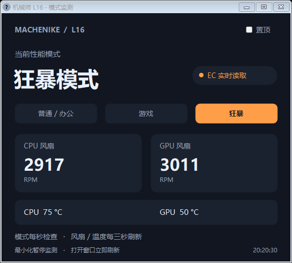

# 机械师曙光 16 模式监测器

**machenike-l16-mode-monitor** 是一个非官方 Windows 小工具，用于读取机械师曙光 16 的当前性能模式、CPU/GPU 风扇转速和 EC 温度。

按电脑原来的 **Fn+3** 切换模式后，窗口显示 EC 返回的实际状态；不依赖机械师控制中心的界面，也不根据按键次数猜测模式。



## 已验证的电脑

| 项目 | 配置 |
| --- | --- |
| 电脑 | 机械师曙光 16，Intel 版 |
| 系统识别型号 | MACHENIKE L16 |
| CPU | Intel Core i7-13650HX |
| GPU | NVIDIA GeForce RTX 4060 Laptop GPU |
| BIOS | 0.18 |
| 运行环境 | Windows x64，.NET Framework 4.8 |

**目前只在上述电脑上完成验证。** AMD 版、其他机型以及不同 BIOS/驱动组合尚未验证；即使名字相同，也不代表兼容。

程序会检查系统厂商、L16 型号及已安装的原厂驱动 SHA-256。驱动不匹配时会停止查询；请不要为了让其他机型运行而直接删除这些检查。

## 功能

- 显示普通/办公、游戏、狂暴模式。
- 显示 CPU/GPU 风扇转速（RPM）和 EC 温度（°C）。温度来自原厂 EC 传感器，不是所有 CPU 核心的最高温度。
- 窗口打开时，模式每秒检查，风扇和温度每三秒刷新；首次打开、恢复窗口或模式变化时读取完整数据。
- 发现模式变化时弹出提示，支持窗口置顶。
- **最小化到托盘后暂停监测并退出读取进程**，重新打开窗口立即刷新。后台暂停期间按 Fn+3 不会弹提示。
- 窗口打开期间复用一个读取进程，避免每次刷新都启动进程引起鼠标加载图标。
- 没读到有效状态时显示“未确认”，并保留查询冲突及超时保护。

这是状态监测程序。Fn+3 的切换由电脑原有机制完成；本程序不设置性能模式、风扇曲线、功耗、BIOS 或开机自启动，也不拦截键盘输入、不访问网络。

## 使用

1. 在仓库的 **Releases** 页面下载 Windows x64 运行包并解压。
2. 双击 `ModeMonitor.exe`。
3. 按原来的 Fn+3 切换，在窗口中查看状态。

最小化会隐藏到托盘并暂停查询；双击托盘图标恢复窗口。关闭窗口，或右键托盘选择“退出”，会结束程序。

## 驱动依赖

需要本机原厂 **`ioportdrv / WTIOportDrv.sys` 已安装且正在运行**。控制中心的界面可以不开，但底层驱动仍然需要保留。

本项目不附带、不安装或启动原厂驱动，不分发原厂 DLL 或控制中心程序。当前支持的驱动 SHA-256：

```text
67DB6E77E353CDA23AFA8DBE9ADF1ECF117B9DE83EE74C34FE63C451D6067DE4
```

若提示驱动访问被拒绝，可尝试以管理员身份运行；本机测试时正常读取不需要管理员权限。

## 从源码构建

在仓库根目录打开 PowerShell：

```powershell
powershell.exe -NoProfile -ExecutionPolicy Bypass -File .\build.ps1
```

`ExecutionPolicy Bypass` 只作用于这次 PowerShell 进程，不修改系统执行策略。脚本使用 Windows .NET Framework 的 C# 编译器，不下载依赖。构建结果在 `artifacts\ModeMonitor.exe`。

也可以直接编译：

```powershell
New-Item -ItemType Directory -Path .\artifacts -Force | Out-Null
& "$env:WINDIR\Microsoft.NET\Framework64\v4.0.30319\csc.exe" /nologo /target:winexe /platform:x64 /optimize+ /reference:System.Drawing.dll /reference:System.Windows.Forms.dll /out:artifacts\ModeMonitor.exe src\ModeMonitor.cs
```

读取一次并输出 JSON：

```powershell
Start-Process -FilePath .\artifacts\ModeMonitor.exe -ArgumentList '--probe mode-snapshot.json' -Wait
Get-Content .\mode-snapshot.json
```

## 验证与限制

已实测 Fn+3 从游戏模式切到狂暴模式，程序能同步显示 EC 返回值。普通、游戏、狂暴的映射为 1、2、3；另外两段循环没有人工按键验证，显示逻辑直接使用当前返回值。

已验证连续刷新复用读取进程、最小化停止查询、恢复立即刷新、快速最小化/恢复、查询冲突后的恢复，以及超时后停止重试。测试记录与内存采样见 [验证记录](docs/verification.md)。

源码及测试方法见 [src/ModeMonitor.cs](src/ModeMonitor.cs) 和 [硬件测试说明](tests/README.md)。
